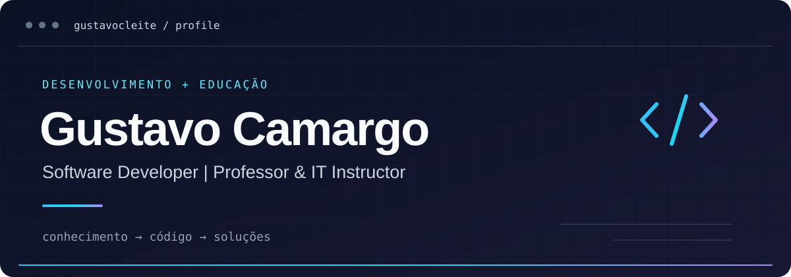

  

  Desenvolvedor de software e professor de Tecnologia da Informação, apaixonado por transformar conhecimento em soluções tecnológicas.

  <a href="https://www.linkedin.com/in/gustavo-camargo-7949a230/">LinkedIn</a> &nbsp;·&nbsp;
  <a href="#projetos-em-destaque">Projetos</a> &nbsp;·&nbsp;
  <a href="https://github.com/gustavocleite?tab=repositories">Todos os repositórios</a>

## Sobre mim

Sou Gustavo Camargo, desenvolvedor de software, professor e instrutor de TI. Atuo no ensino técnico e na graduação em tecnologia, aproximando fundamentos de programação e prática de desenvolvimento.

Meu trabalho reúne desenvolvimento de aplicações, programação orientada a objetos, desenvolvimento web e backend, banco de dados e infraestrutura de TI. Tenho interesse em arquitetura de software, automação e novas tecnologias, com atenção à clareza das soluções e à construção de conhecimento.

Nos repositórios públicos, compartilho projetos em Java e uma aplicação Angular que consome uma API, além de exemplos de manipulação de arquivos utilizados no ensino de Engenharia de Software.

## Tech stack

Tecnologias identificadas nos projetos públicos e na minha apresentação profissional.

**Linguagens**

**Frontend**

**Ferramentas de desenvolvimento**

**Integrações**

## Projetos em destaque

<!-- Para adicionar um projeto, repita um bloco com título, descrição, tecnologias e link. -->

### 01 · SCGV

**Gestão de gastos veiculares**

Sistema de Controle de Gastos Veicular desenvolvido em Java. Um projeto voltado à aplicação da programação em um contexto de gestão.

`Java` &nbsp; **[Explorar repositório ↗](https://github.com/gustavocleite/SCGV)**

---

### 02 · ecommerce-ads

**Desenvolvimento aplicado à graduação**

Projeto acadêmico de e-commerce do quarto período de ADS, com código em Java e estrutura de construção Maven.

`Java` `Maven` &nbsp; **[Explorar repositório ↗](https://github.com/gustavocleite/ecommerce-ads)**

---

### 03 · app-dragon-ball-z

**Frontend e integração com API**

Aplicação Angular que consome a API de Dragon Ball, conectando uma interface web a dados externos.

`TypeScript` `Angular` `Consumo de API` &nbsp; **[Explorar repositório ↗](https://github.com/gustavocleite/app-dragon-ball-z)**

---

### 04 · ManipulacaoArquivo

**Código como ferramenta de ensino**

Exemplos de manipulação de arquivos em Java para uma turma de graduação em Engenharia de Software. Material que aproxima conceitos de programação e prática em sala de aula.

`Java` `Manipulação de arquivos` &nbsp; **[Explorar repositório ↗](https://github.com/gustavocleite/ManipulacaoArquivo)**

## Atividade no GitHub

Explore meu [histórico de contribuições](https://github.com/gustavocleite?tab=overview) e os [repositórios públicos](https://github.com/gustavocleite?tab=repositories) para acompanhar os projetos e sua evolução.

## Vamos conversar

Para trocar ideias sobre desenvolvimento de software, ensino de tecnologia e projetos, conecte-se comigo no [LinkedIn](https://www.linkedin.com/in/gustavo-camargo-7949a230/).
